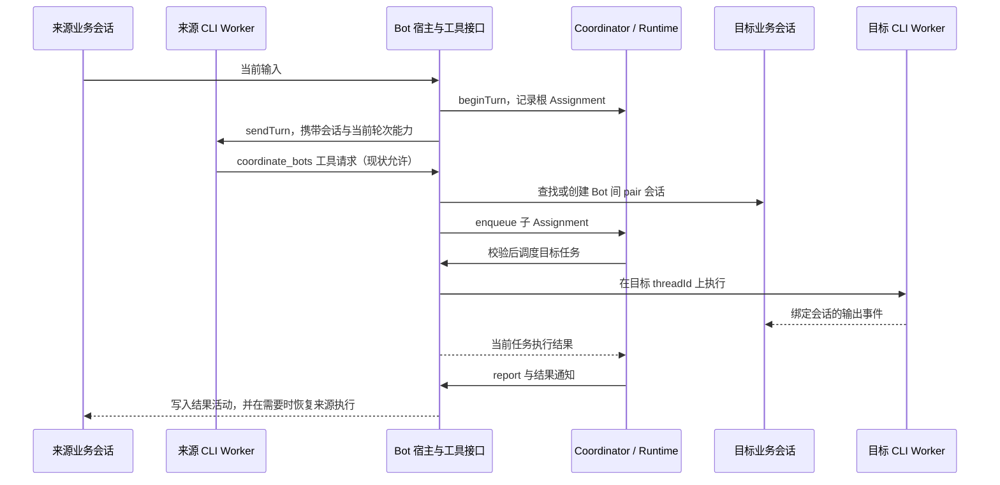

# Bot、Worker 与 Session：变更前业务逻辑基线

本文依据 2026-11-15 的 Touko 源码编写，基线提交为 `6706cfe`，记录本轮清理前的委派与会话行为。它是历史基线，不代表当前工作区的完整现状。

后续清理已回退 Bot 私聊设计，并移除自动化/日历功能及设置中的网站登录凭据、管理员活动记录和工作区备份。本文涉及这些能力的描述仅用于解释变更前行为；Bot / Worker 权限边界和每个逻辑 Session 独占 CLI 进程的目标，也不因本次清理而视为已经实现。

范围仅包括：Bot 发起委派、业务会话与 Worker CLI 的绑定、任务输入输出、结果回传及相关生命周期。运行环境为项目同级的 `dev-env`，本地执行 CLI 为 `omp`。没有读取现有业务数据、凭据文件或其他业务文档，也没有修改运行代码或新增测试文件。

## 1. 本次需要评估的目标约束

以下三条来自本次需求：

1. Bot 是唯一的委派发起方，也是唯一的会话生命周期管理者。
2. Worker Agent 是底层执行单元，可由 Cursor、Codex、omp CLI 承载；一个逻辑 Session 独占一个独立 CLI 进程。
3. Worker 单次任务只能接收绑定 Session 的输入，并把输出交回该 Session；Worker 无权主动创建新 Session 或发起额外任务请求。

**当前实现尚未形成上述 Bot / Worker 分权。** 目前 Bot 是持久的业务身份，CLI 中的模型执行该 Bot 的一轮任务，同时能够通过宿主提供的工具请求协作与部分会话管理操作。宿主校验请求并执行状态修改，但模型仍是这些请求的实际发起端。

## 2. 当前代码中的对象与对应关系

| 对象 | 当前含义 | 与目标逻辑 Session 的关系 |
| --- | --- | --- |
| Bot | 持久的业务身份，持有模型选择及多个 TaskRecord | 一个 Bot 可以有多个业务会话；不是一个 CLI 进程 |
| TaskRecord / threadId | Bot 名下的业务会话，保存消息关联、状态和原生恢复游标 | 是现状中最接近目标逻辑 Session 的对象，尚需评估后确定是否直接沿用 |
| Assignment | 一次请求或委派的运行记录，保存 requester、assignee、父子关系、结果和状态 | 属于任务调度，不等同于业务会话；可在一个会话内执行多轮 |
| generation | 宿主为当前执行轮次生成的标识 | 用于区分同一会话的不同轮次、绑定能力和处理取消竞态 |
| turnId | 驱动报告的一轮执行标识 | 用于关联输出、完成事件与当前执行 |
| Provider instance | 一套驱动实例和配置 | 可服务多个业务会话；实例本身不是 Worker 进程 |
| CLI 原生 session | CLI 自己维护的上下文，例如 Codex thread、ACP session、omp sessionFile | 通过恢复游标关联业务会话，不等同于操作系统进程 |
| CLI 进程 | 宿主实际启动的执行进程 | 当前是否跨轮保留取决于驱动，尚无统一的逻辑 Session 生命周期模型 |

业务会话保存 `resumeCursors[instanceId]`，收到 `session.started` 后由宿主更新。因而同一业务会话可保留不同驱动实例的原生恢复信息，不能把一个游标当作一个永久存活的进程。`bot.threadId` 主要代表当前选择的会话，也不能视为 Bot 唯一且永久的 Session。

代码入口：`server/harness/contracts.ts:79`、`server/storage/store.ts:287`、`:1616`、`:1922`、`:1929`、`:1942`，`server/index.ts:4289`。

## 3. 当前主链路

图中描述的是现有行为：模型从绑定会话发起协作请求，宿主负责创建/选择目标会话、调度与回传。目标要求的“Worker 不发起额外任务”目前尚未成立。

### 3.1 输入与执行启动

宿主确定 `botId` 和 `threadId`，处理当前输入，并生成 `dispatchClaimId` 作为 generation。直接请求通常通过 `coordinator.beginTurn` 登记根 Assignment；被委派的执行沿用已有协调节点，不再按普通请求重复创建根节点。

启动前，宿主建立当前会话的执行占用和能力 generation；之后调用驱动的 `sendTurn`，传入 `threadId`、`botId`、输入、原生恢复游标、重置标志、恢复文本、系统上下文和本轮工具桥。CLI session 在首次 turn 时隐式建立。

当前调度会避免同一会话同时执行多个 turn；Bot 的多个会话则可以分别排队或并行。这是执行轮次的串行规则，不等于已经建立整个逻辑 Session 与进程的固定一对一关系。

代码入口：`server/index.ts:5569`、`:5602`、`:5874`、`:5988`，`server/runtime/runtime.ts:295`，`server/harness/contracts.ts:79`。

### 3.2 委派发起与目标会话选择

当前 Worker 能获得 `agents` MCP 工具桥。工具集提供 `coordinate_bots`，模型可提交目标 Bot 和任务内容；工具请求转换为宿主的 `POST /api/internal/coordinate-bots`。

宿主从 capability 得到来源 Bot 和会话，并校验来源会话归属、目标可达性及审批条件。随后按来源/目标 Bot 查找持久 pair 会话；不存在时调用 `store.createTask` 创建，再通过 `coordinator.enqueue` 写入子 Assignment。

工具协议仍接受 `thread: standing/new`，但当前这条实现实际按 pair 会话逻辑选址，下游 enqueue 固定采用 `standing`。不能依据工具参数说明，推断传入 `new` 必然每次创建新会话。

`POST /api/internal/threads` 已返回 410，独立创建个人会话的旧入口已停用；但 `coordinate_bots` 仍可间接触发目标会话创建，因此不能把该 410 当作 Worker 禁止创建 Session 的完整保证。

代码入口：`server/drivers/agents-catalog.ts:216`，`server/drivers/agents-call.ts:173`，`server/index.ts:8698`、`:8771`、`:8901`、`:8954`。

### 3.3 委派接纳与调度

Coordinator 要求父 Assignment 存在且仍为 `running`，来源 Bot / thread 必须与父 Assignment 的执行方一致。requester 从父 Assignment 派生，模型不能在此任意指定结果接收会话。

现有约束还包括禁止回派祖先、相同任务去重、限制委派深度和无进展预算。这些规则约束委派树，但仍允许执行中的节点继续向下委派，并没有把 Worker 定义为不可再委派的叶子节点。

Runtime 将 Assignment、事件及通知持久化到 `runtime.db`。`tick()` 统一接纳和调度队列中的工作；执行前校验目标会话及宿主的忙碌条件，同一会话的执行不重叠。

代码入口：`server/teams/runtime-coordinator.ts:102`、`:152`、`:172`、`:383`，`server/runtime/runtime.ts:174`、`:295`、`:330`。

## 4. 当前 CLI 进程与原生会话生命周期

| CLI | 进程创建与复用 | 原生上下文恢复 | 正常一轮结束后 |
| --- | --- | --- | --- |
| omp | 每次 `sendTurn` 创建新 CLI 进程，同一 threadId 不允许并发执行 | 使用 `resumeCursor` 中的 sessionFile；有游标请求 `switch_session`，无游标请求 `new_session` | 结算后关闭 stdin、结束 CLI 进程树、移除 active 记录并删除临时 MCP 配置 |
| Codex | 每次 `sendTurn` 创建新的 `codex app-server` 进程 | 使用 `thread/resume`；符合恢复条件时可从会话重放文本建立新的原生 thread | 结算过程中停止仍运行的 turn，结束 CLI 进程树，移除 active 记录 |
| Cursor | 使用 ACP core，为 threadId 保留 session 连接和进程，可跨轮复用 | 优先使用当前原生 session；否则 `session/load`，必要时 `session/new` 并恢复上下文 | 正常完成后保留进程，默认闲置 10 分钟退出；重置、绑定合同变化、故障或销毁也会关闭/替换 |

这三种驱动的现状不能统一表述为“一个逻辑 Session 生命周期内始终对应同一个 CLI 进程”：

- omp / Codex 在不同轮次使用不同进程，恢复的是上下文。
- Cursor 更接近会话持有进程，但闲置回收或配置变化后也会重建进程。
- 当前的 busy / active / session Map 与恢复游标分散在宿主和各驱动中，没有统一的 Worker 角色及 Session—进程绑定记录。

omp 还有一条需要注意的现状：`new_session` / `switch_session` 握手失败可被捕获后继续发送 prompt，理由是 `--no-session` 模式仍能接收输入。因此当前不能声称“原生会话绑定失败时一定拒绝执行”。

代码入口：

- omp：`server/drivers/pi.ts:29`、`:457`、`:464`、`:501`、`:554`、`:815`、`:832`。
- Codex：`server/drivers/codex.ts:723`、`:841`、`:956`、`:1564`、`:1617`。
- Cursor / ACP：`server/drivers/acp/cursor.ts:392`，`server/drivers/acp/core.ts:532`、`:549`、`:569`、`:700`、`:753`、`:1336`、`:1511`。
- 闲置策略：`server/drivers/session-idle.ts:6`、`:18`。

## 5. 输出归属与结果回传

### 5.1 Worker 输出如何进入当前业务会话

驱动把 CLI 原生事件转换为 Touko RuntimeEvent。事件上的业务 `threadId` / `turnId` 来自宿主启动执行时建立的上下文，普通 CLI 文本不能直接选择写入哪个 Touko 会话。宿主据这些标识写入消息、记录活动和结算本轮执行。

已有实现还处理异步启动与取消竞态：启动期间被取消的执行会在启动完成后再次中断；过期 turn 会登记并过滤；完成事件与 generation 按 turnId 关联，未绑定的提前完成事件不会直接归给当前新轮次。

但不能据此宣称所有原生事件都已做强会话校验：Codex 会过滤不匹配的 native thread / turn 通知；ACP 的普通 `session/update` 内容和工具事件主要归给该连接的 current turn，并非所有分支都显式核对 `p.sessionId`。

代码入口：`server/drivers/pi.ts:448`，`server/drivers/codex.ts:660`、`:1204`、`:1225`，`server/drivers/acp/core.ts:621`、`:1051`，`server/agent/turn-dispatch-guard.ts:7`、`:44`，`server/index.ts:1708`、`:3582`、`:4289`。

### 5.2 一次委派的结果如何回到请求方

被委派 Worker 的正常输出首先属于它执行的目标业务会话；宿主将本轮文本或失败原因提交给 Runtime 结算。Runtime 根据是否仍有待返回的子任务、是否需要用户输入等条件，决定结束、等待或继续。

子 Assignment 结算后，宿主的 report 将结果活动写入父 Assignment 的 `parent.threadId`。通知接收方从 Assignment 的 requester 派生，不由 Worker 重新指定。Runtime 用 `reportedAt` 防止正常流程重复报告，并通过 inbox 记录唤醒；需要恢复时，把已完成的子结果组合成请求方下一轮输入。返回内容前还有访问校验。

因此必须区分两件事：

- CLI 本轮输出被绑定到自己的执行会话。
- 宿主仍会根据此前接受的委派关系，把结果转交另一个请求会话。

前者已有绑定机制；后者是当前平台的编排行为。目标要求 Worker 只交回当前 Session，后续跨 Session 的决策和转交应由 Bot 控制层承担，具体形式等待下一阶段细化。

代码入口：`server/index.ts:2968`、`:3588`，`server/runtime/runtime.ts:396`、`:409`、`:597`、`:613`，`server/runtime/tree.ts:107`，`server/teams/runtime-coordinator.ts:400`、`:446`。

## 6. 当前任务状态、停止和恢复

Assignment 的状态是任务状态，不是 CLI 进程状态：

| 状态 | 当前含义 | 后续行为 |
| --- | --- | --- |
| queued | 已记录、等待执行或继续执行 | 满足调度条件后进入 running |
| running | 当前正在执行 | 根据执行结果结算、等待或挂起 |
| needs_input | 等待用户回答或处理卡片 | 回答后重新入队 |
| waiting | 当前轮结束，但仍需接收子任务结果 | 子任务结算后转入 resume |
| resume | 需要消费子结果再运行一轮 | 调度后进入 running |
| completed / failed / cancelled | 本次 Assignment 已结束 | 报告结果，按既定关系通知请求方 |

触及执行上限等继续条件时，可以把同一 Assignment 重新入队，并记录 continuation；这不要求新建业务会话。

宿主重启时从持久化记录恢复：已等待用户输入的任务重新挂起；被打断且已交出子任务的执行等待子结果；没有已完成外部动作的中断执行可安排一次原地重跑；存在已完成外部动作或连续被打断的情况会按现有规则失败，避免直接重复操作。此处恢复的是任务及上下文，原 CLI 进程不会跨宿主重启继续保持。

停止来源会话也不等于立即终止所有后代：现有 `stopRequester` 会取消尚未开始的子任务，已经执行中的队友可能继续完成并报告，来源会话不再自动恢复。

会话关闭也与进程退出不同：`close_thread` 主要记录 `closedBy`；pair 私聊不可这样关闭，当前说话的会话、运行中、排队中或等待用户回答的会话也不能关闭。关闭标记不是统一的 Worker 销毁指令。

代码入口：`server/runtime/types.ts:56`，`server/runtime/runtime.ts:77`、`:409`、`:516`，`server/routes/internal-threads.ts:72`。

## 7. 当前权限绑定的保护范围

### 7.1 已有的来源身份约束

宿主保存的 InternalCapability 绑定 `botId`、`threadId`、`generation` 及服务种类，工具代理携带该能力访问内部路由。请求中自报的身份仅用于一致性检查，不能替代 capability 里的来源身份。常规能力跟随当前 generation 生效，切换轮次或停止时撤销旧能力。代理 bearer 可以为了进程复用保持稳定，但对应的宿主能力记录按轮更新和撤销。

这类约束主要防止冒充其他来源会话、继续使用过期轮次能力，以及把结果随意发给其他会话。**它没有禁止当前 Worker 以自身绑定的 Bot 身份发起新的委派。**

代码入口：`server/index.ts:955`、`:1022`、`:1029`、`:1076`、`:1143`、`:1165`、`:8127`。

### 7.2 尚未收回的编排与生命周期能力

普通工具目录包含 `coordinate_bots`、`list_threads` 和 `close_thread`。`close_thread` 在权限范围内可操作自己的其他会话、自己在队友处开的会话等。目录当前没有独立 Worker 角色来统一剥离这些能力。工具通过 `find_tool` / `use_tool` 动态发现时，仍使用同一权限和路由，隐藏直接入口不等于取消权限。

omp 的 MCP 扩展会根据本轮 toolScope 筛选工具，但这是通用工具范围控制，并非固定的 Worker 禁委派策略。toolScope 未定义时，不会自动应用这套范围限制。

另外，CLI 自带的 helper / subagent 能力和 Touko 平台的会话、委派是两个层次。当前所读核心代码不足以证明 CLI 原生额外任务能力已经统一关闭；omp 本地帮助信息明确将 `task` 列为默认启用的工具之一。后续需要明确禁止范围，并以实际 Worker 启动配置验证，不能只删平台工具或只加提示词便认定完成。

代码入口：`server/drivers/agents-catalog.ts:7`、`:216`、`:259`、`:265`、`:745`，`server/drivers/agents-bridge.ts:139`、`:198`，`server/drivers/agents-proxy.ts:51`，`server/drivers/pi-mcp-extension.ts:587`、`:594`。

### 7.3 外部 runtime 绑定入口

另有外部 runtime token 通道，绑定到明确的 Bot 和未归档业务会话，并在等待后复查绑定有效性。该通道限制了可调用端点，但仍明确允许 `coordinate-bots`，结果采用 poll 返回。

它不等同于普通 CLI Worker 的启动绑定，也不能作为“执行端只有回传权限”的证据；如果后续它仍被用来接入 Worker，必须一并纳入权限边界。

代码入口：`server/agent/external-runtime.ts:48`、`:72`，`server/index.ts:997`、`:8136`、`:8757`、`:8843`。

## 8. 与目标约束的差异

| 目标约束 | 当前实现 | 评估结论 |
| --- | --- | --- |
| 只有 Bot 发起委派 | CLI 模型可通过其 Bot 身份调用 coordinate_bots，执行节点可继续下派 | 尚未分离编排角色与执行角色 |
| 只有 Bot 管理 Session 生命周期 | 实际状态变更由宿主执行，但模型仍可请求关闭会话或通过协作间接创建会话 | 宿主执行修改不等于 Worker 没有发起权 |
| 一个逻辑 Session 独占独立 CLI 进程 | omp / Codex 按轮创建和销毁进程；Cursor 可复用但会回收或重建 | 尚无统一的 Session—进程生命周期约束 |
| Worker 只接收当前绑定 Session 的输入 | 发送入口携带明确 threadId，已有并发和轮次约束；原生绑定失败处理及事件检查强度因驱动不同 | 有基础绑定，仍需统一绑定成功条件及失效处理 |
| Worker 结果只交回当前 Session | 常规输出事件由宿主绑定；委派结果由宿主按 requester 转交 | 需要在设计中明确 Worker 输出与 Bot 转交结果的接口边界 |
| Worker 无权创建 Session 或发起额外任务 | 平台协作入口仍开放，CLI 原生额外任务能力未统一证明被禁止 | 当前不能认定满足 |

## 9. 本地 omp 直接运行记录

本轮使用 `dev-env/.venv/Scripts/python.exe` 直接启动本机 omp，没有创建测试文件，也没有通过业务 API 创建或修改会话。

验证环境：

- CLI：`C:/Users/11699/AppData/Local/omp/omp.exe`，`omp --version` 返回 `omp/18.20.0`。
- 工作目录：独立的临时空目录，避免把项目其他文件送入模型上下文。
- 参数：`--mode rpc --no-session --no-ui --no-tools --no-extensions --no-skills --no-rules --no-context-files --no-lsp --no-title`；模型回复验证额外使用 `--thinking off`。

| 直接调用 | 观察结果 |
| --- | --- |
| negotiate_protocol，protocolVersion=2 | success=true，返回协议版本 2 |
| get_state | success=true；首次探测 messageCount=0、isStreaming=false，并返回原生 sessionId |
| prompt：要求仅回复 TOUKO_OMP_OK | prompt 被接受，文本增量合并为 `TOUKO_OMP_OK` |
| 一轮结束 | 收到 turn_end，stopReason=stop，随后收到 agent_end |
| 清理 | 两次探测创建的进程均已结束，临时目录随探测退出清理 |

该记录证明本地 omp 可运行 RPC 和完成基本输入输出，不证明 Touko 的 MCP 扩展、跨会话隔离、会话恢复或禁止额外委派已经通过端到端验证。探测使用的禁工具参数是本次检查配置，不是当前项目 Worker 默认启动参数。

## 10. 评估后需要细化的边界

以下仅记录需求尚未定下的语义，不在本轮自行选定实现：

1. 逻辑 Session 是否直接采用现有 `botId + threadId`，还是新增独立对象并关联业务会话。
2. Session 独占进程是否要求整个生命周期始终保持同一个进程；发生崩溃、闲置、恢复或切换驱动时，Bot 如何结束或重建绑定。
3. 一个 Worker 单次任务结束后，是保留进程等待同 Session 的下一次输入，还是由 Bot 显式结束 Session。
4. Worker 请求更多信息、执行失败或认为需要其他任务时，向当前 Session 返回什么结构，由 Bot 如何决定后续动作。
5. CLI 原生 subagent / helper 是否全部禁止，以及允许的工具如何表达和验证这一边界。

本轮交付止于上述现状与差异，运行逻辑调整等待评估后的细化要求。
人话讲一下
